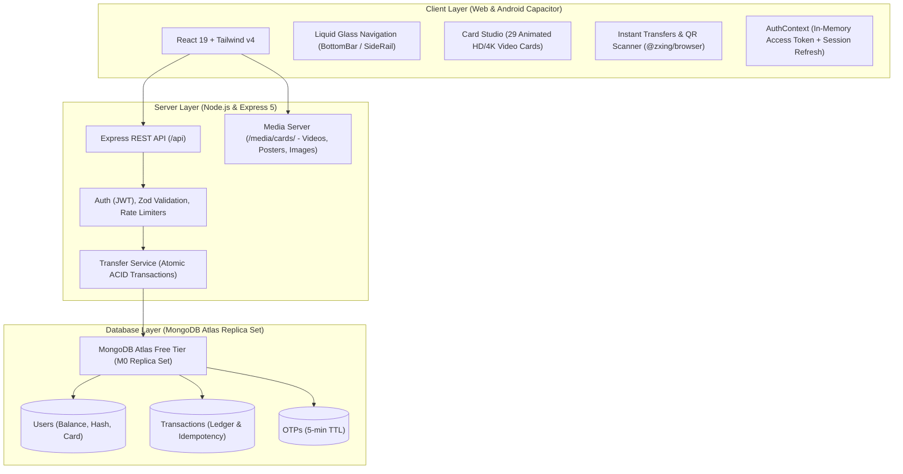

# NovaBank — Digital Banking Simulation

> **Simulation Notice**: Fictional banking simulation for educational and college demonstration purposes. No real money, real bank accounts, or real card networks are used.

NovaBank is a full-stack digital banking experience featuring personalized virtual cards with animated HD/4K video loops, a liquid-glass navigation bubble, and atomic multi-document money transfers powered by MongoDB replica set transactions.

---

## Architecture Diagram



---

## Tech Stack

| Layer | Technology | Details |
|---|---|---|
| **Frontend** | React 19, Vite 6, Tailwind CSS v4 | `@tailwindcss/vite`, ES modules |
| **Motion & Physics** | `motion` (Framer Motion) | Spring dynamics (stiffness: 380, damping: 28) |
| **Typography** | `@fontsource/*` (Self-Hosted) | Orbitron, Anton, Press Start 2P, Bangers, Cinzel, Bebas Neue, DM Sans |
| **Mobile App** | Capacitor 8 | Android native project, Haptics, Status Bar, App lifecycle |
| **Backend** | Express 5, Node.js | REST API, Zod schema validation, Helmet, CORS |
| **Database** | MongoDB Atlas / Mongoose 9 | Atomic multi-document transactions via replica set |
| **Auth & Security** | JWT, bcrypt, SHA-256 | 15-min access tokens, SHA-256 hashed refresh tokens, PIN lockout, phone-keyed rate limiting |
| **Testing** | Vitest | 49 backend integration & regression tests + 7 client money tests |

---

## Prerequisites

- **Node.js**: v18.0.0+ or v20.0.0+
- **npm**: v9.0.0+
- **MongoDB Atlas Account**: (Free M0 replica set cluster)
- **ffmpeg & ffprobe**: Required for video transcoding pipeline
- **Java JDK 17+ & Android SDK**: (Only required if building the native Android APK)

---

## MongoDB Atlas Setup Guide

MongoDB multi-document transactions (`session.withTransaction()`) strictly require a replica set. A standalone local `mongod` will fail transactions.

1. **Create Free Cluster**: Sign in to [MongoDB Atlas](https://www.mongodb.com/cloud/atlas) and create an **M0 Free Tier** cluster (automatically provisioned as a 3-node replica set).
2. **Network Access**:
   - Go to **Network Access** in the Atlas dashboard.
   - Click **Add IP Address** and add `0.0.0.0/0` (Allow access from anywhere for development) or your current IP.
3. **Database Access**:
   - Go to **Database Access** and click **Add New Database User**.
   - Create a username and secure password with `readWriteAnyDatabase` privileges.
4. **Copy Connection String**:
   - Click **Connect** on your cluster -> **Drivers** -> Node.js.
   - Connection string format:
     ```
     mongodb+srv://<username>:<password>@<cluster>.mongodb.net/novabank?retryWrites=true&w=majority
     ```
5. **Configure Environment**:
   - Save this string in `server/.env` as `MONGODB_URI`.

---

## Setup in ≤10 Steps

1. **Clone repository**:
   ```bash
   git clone <repo-url> "d:/Bank Simulator"
   cd "d:/Bank Simulator"
   ```
2. **Install root & workspace dependencies**:
   ```bash
   npm install
   npm --prefix server install
   npm --prefix client install
   ```
3. **Create `server/.env`** (copy from `.env.example`):
   ```bash
   cp server/.env.example server/.env
   ```
4. **Set your MongoDB URI** in `server/.env`:
   ```env
   MONGODB_URI=mongodb+srv://<user>:<password>@cluster.mongodb.net/novabank?retryWrites=true&w=majority
   ```
5. **Generate secret keys** (optional, default script generates random 64-byte hex keys):
   ```bash
   node -e "console.log(require('crypto').randomBytes(64).toString('hex'))"
   ```
6. **Run media pipeline** (transcodes card videos into 4 quality tiers and extracts posters):
   ```bash
   node tools/transcode-videos.js
   node tools/build-manifest.js
   ```
7. **Run server tests** to verify Atlas & in-memory replica set:
   ```bash
   npm --prefix server test
   ```
8. **Run client tests**:
   ```bash
   npm --prefix client test
   ```
9. **Start the backend server**:
   ```bash
   npm --prefix server run dev
   ```
10. **Start the frontend application** (open `http://localhost:5173`):
    ```bash
    npm --prefix client run dev
    ```

---

## API Endpoints

### Authentication (`/api/auth`)
| Method | Path | Description | Protection |
|---|---|---|---|
| `POST` | `/api/auth/register` | Register new user (min age 16) | Rate-limited |
| `POST` | `/api/auth/otp/request` | Request 6-digit OTP | Rate-limited |
| `POST` | `/api/auth/otp/verify` | Verify OTP code | Rate-limited |
| `POST` | `/api/auth/pin` | Set initial 6-digit PIN | Temp token |
| `POST` | `/api/auth/pin/change` | Change PIN (validates current PIN) | Bearer token |
| `POST` | `/api/auth/login` | Login with phone + PIN (15-min lockout) | Rate-limited |
| `POST` | `/api/auth/refresh` | Refresh access token | SHA-256 token |
| `POST` | `/api/auth/logout` | Revoke active refresh token | Bearer token |

### Account & User (`/api`)
| Method | Path | Description | Protection |
|---|---|---|---|
| `GET` | `/api/me` | Fetch profile, balance & active card | Bearer token |
| `PATCH` | `/api/me/settings` | Update theme, glass, motion, haptics | Bearer token |
| `PATCH` | `/api/me/card` | Update active card design | Bearer token |
| `GET` | `/api/accounts/lookup` | Resolve verified recipient name | Bearer token |

### Banking & Ledger (`/api`)
| Method | Path | Description | Protection |
|---|---|---|---|
| `POST` | `/api/transfers` | Atomic transfer with PIN & idempotency | Bearer token + Rate-limited |
| `POST` | `/api/deposits` | Add demo funds (max ₹50,000) | Bearer token |
| `POST` | `/api/withdrawals` | Withdraw demo funds | Bearer token |
| `GET` | `/api/transactions` | Passbook ledger (filter: all/in/out) | Bearer token |
| `GET` | `/api/transactions/:id` | Single transaction audit record | Bearer token |

### Cards & System
| Method | Path | Description | Protection |
|---|---|---|---|
| `GET` | `/api/cards` | 29-card manifest with video tiers | Public |
| `GET` | `/api/health` | Service and MongoDB status | Public |

---

## Building the Android APK

1. Build client web assets:
   ```bash
   cd client
   npm run build
   ```
2. Sync Capacitor Android project:
   ```bash
   npx cap sync android
   ```
3. Compile debug APK using Gradle:
   ```bash
   cd android
   ./gradlew assembleDebug
   ```
4. Output APK is generated at:
   `client/android/app/build/outputs/apk/debug/app-debug.apk`

---

## Verification & Test Results

- **Server Test Suite**: `npm --prefix server test` runs 49 automated tests across 9 suites (concurrency double-spend prevention, transfer ACID transactions, Indian daily limits in Asia/Kolkata timezone, 15-minute PIN lockout, SHA-256 refresh tokens, health checks, boundary conditions, and real-phone bug regressions). All 49 passed.
- **Strict Rate Limiting & Zero Exemption**: The reserved test phone range no longer bypasses any limiter. All tests exercise the exact same production rate-limiting code paths (keyed by phone number, with IP fallback), using injectable `resetRateLimiters()` to clear counters between test runs.
- **Client Test Suite**: `npm --prefix client test` runs Vitest money parsing and Indian formatting unit tests. All 7 passed.
- **Live Atlas E2E Flow**: `node tools/verify-e2e-flow.js` executes 9 end-to-end verification stages against MongoDB Atlas with zero console errors.

---

## Screenshots

- **Mobile Viewport (390px)**: `docs/screenshots/welcome-mobile-390px.png`, `docs/screenshots/login-mobile-390px.png`, `docs/screenshots/glass-nav-390px.png`
- **Desktop Viewport (1280px)**: `docs/screenshots/welcome-desktop-1280px.png`
- **Glass Optical Blur Verification**: `docs/screenshots/blur-comparison-full-vs-off.png`, `docs/screenshots/alignment-proof-debug-390.png`

---

## Known Limitations

- **Fictional Simulation**: No real monetary exchange or payment gateway processing.
- **Atlas Replica Set**: Requires an active internet connection to reach MongoDB Atlas (or a local MongoDB replica set). Standalone MongoDB instances do not support ACID transactions.
- **QR Scanner on Web**: Requires camera permissions (`https://` or `localhost`).
