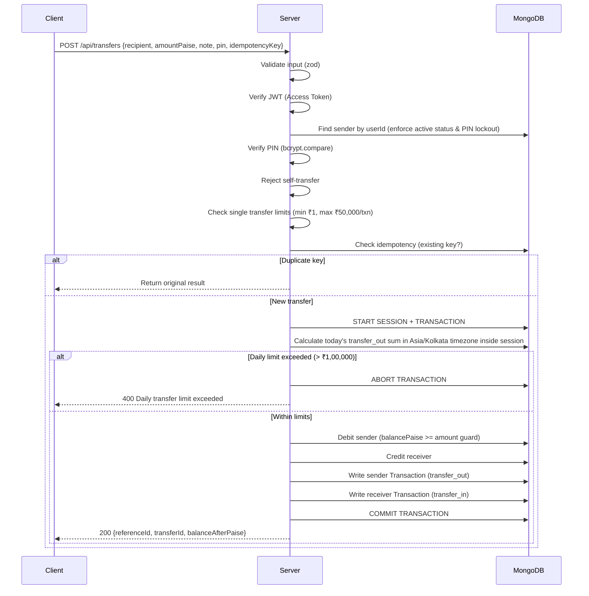

# NovaBank — Architecture & Build Plan

## 1. Project Overview

NovaBank is a fictional digital banking simulation for a college project. It ships as:
- A **responsive website** (React + Vite, Tailwind CSS)
- An **Android APK** via Capacitor (same React codebase)
- One shared **Express + MongoDB** backend

Signature features: personalized virtual cards with animated video backgrounds, and a liquid-glass navigation bubble.

A "Fictional banking simulation. No real money." notice appears on the Welcome screen and in Profile.

---

## 2. Monorepo Layout

```
d:\Bank Simulator\
├── README.md                       # Setup in ≤10 steps
├── package.json                    # Root workspace config
├── .env.example                    # All env vars documented (VITE_API_BASE_URL, VITE_MEDIA_BASE_URL, DEMO_SHOW_OTP, MONGODB_URI, etc.)
├── .gitignore                      # Relative paths with /Cards/ anchored; no committed media
│
├── server/
│   ├── package.json
│   ├── src/
│   │   ├── index.js                # Express app entry (ES modules)
│   │   ├── config/
│   │   │   ├── env.js              # dotenv + defaults (CORS allow-list including Capacitor)
│   │   │   ├── db.js               # Mongoose connection
│   │   │   └── limits.js           # Configurable limits (amounts, rates, age)
│   │   ├── middleware/
│   │   │   ├── auth.js             # JWT verification
│   │   │   ├── rateLimiter.js      # express-rate-limit configs
│   │   │   ├── validate.js         # Generic zod validator
│   │   │   └── errorHandler.js     # Central error handler
│   │   ├── models/
│   │   │   ├── User.js             # User model with status ('pending'/'active'), PIN lockout & SHA-256 refresh tokens
│   │   │   ├── Transaction.js
│   │   │   └── Otp.js
│   │   ├── routes/
│   │   │   ├── auth.routes.js      # Includes PIN change route
│   │   │   ├── account.routes.js
│   │   │   ├── transfer.routes.js
│   │   │   ├── transaction.routes.js
│   │   │   └── card.routes.js
│   │   ├── controllers/
│   │   │   ├── auth.controller.js
│   │   │   ├── account.controller.js
│   │   │   ├── transfer.controller.js
│   │   │   ├── transaction.controller.js
│   │   │   └── card.controller.js
│   │   ├── services/
│   │   │   ├── auth.service.js
│   │   │   ├── otp.service.js
│   │   │   ├── transfer.service.js
│   │   │   └── account.service.js
│   │   └── utils/
│   │       ├── accountNumber.js    # NB + 10 digits generator
│   │       ├── referenceId.js      # Unique ref ID
│   │       ├── cardNumber.js       # 9000-prefix demo numbers
│   │       └── tokens.js           # JWT sign/verify + random SHA-256 refresh tokens
│   └── tests/
│       ├── setup.js                # mongodb-memory-server (replica set)
│       ├── auth.test.js
│       ├── transfer.test.js
│       ├── transaction.test.js
│       └── concurrency.test.js
│
├── client/
│   ├── package.json                # Self-hosted @fontsource packages, Vite, Tailwind v4 (@tailwindcss/vite), motion, @zxing/browser, @zxing/library
│   ├── vite.config.js              # Uses @tailwindcss/vite plugin (no tailwind.config.js or postcss.config.js)
│   ├── index.html
│   ├── capacitor.config.ts         # Live-reload (server.url) vs production APK with androidScheme
│   ├── public/
│   │   └── fonts/                  # Optional user-placed theme fonts; self-hosted @fontsource fallbacks
│   └── src/
│       ├── main.jsx
│       ├── App.jsx
│       ├── index.css               # CSS vars, GlassSurface styles, @import "tailwindcss";
│       ├── api/
│       │   ├── client.js           # Axios/fetch instance with token refresh & VITE_API_BASE_URL
│       │   ├── auth.js
│       │   ├── accounts.js
│       │   ├── transfers.js
│       │   ├── transactions.js
│       │   └── cards.js            # Automatically prefixes media paths with VITE_MEDIA_BASE_URL
│       ├── context/
│       │   ├── AuthContext.jsx
│       │   ├── ThemeContext.jsx
│       │   └── GlassContext.jsx
│       ├── hooks/
│       │   ├── useAuth.js
│       │   ├── useGlass.js
│       │   ├── useSwipe.js         # Explicit order: Home (0) <-> Passbook (3) <-> Profile (4)
│       │   ├── useDragBubble.js
│       │   └── useMediaQuery.js
│       ├── components/
│       │   ├── glass/
│       │   │   ├── GlassSurface.jsx
│       │   │   ├── GlassBubble.jsx
│       │   │   ├── BottomBar.jsx
│       │   │   ├── SideRail.jsx
│       │   │   └── SegmentedControl.jsx
│       │   ├── cards/
│       │   │   ├── CardFace.jsx    # NO chip elements, SVGs or icons
│       │   │   ├── CardCarousel.jsx
│       │   │   ├── CardCatalog.jsx # Shows ONLY cards with art; category filters only for populated categories
│       │   │   └── CardPreview.jsx
│       │   ├── common/
│       │   │   ├── BottomSheet.jsx # Renders through portal to <body>
│       │   │   ├── Modal.jsx       # Renders through portal to <body>
│       │   │   ├── PinInput.jsx
│       │   │   ├── OtpInput.jsx
│       │   │   ├── AmountInput.jsx
│       │   │   ├── Button.jsx
│       │   │   ├── LoadingSpinner.jsx
│       │   │   └── SimulationNotice.jsx
│       │   └── layout/
│       │       ├── AppShell.jsx    # Nav + animated page container as siblings
│       │       └── PageTransition.jsx
│       ├── pages/
│       │   ├── Welcome.jsx
│       │   ├── Register.jsx
│       │   ├── OtpVerify.jsx
│       │   ├── SetPin.jsx
│       │   ├── ChooseCard.jsx
│       │   ├── AccountCreated.jsx
│       │   ├── Login.jsx
│       │   ├── Home.jsx
│       │   ├── Cards.jsx
│       │   ├── Pay.jsx
│       │   ├── Send.jsx
│       │   ├── Receive.jsx
│       │   ├── Scan.jsx            # Portal to <body>, camera starts ONLY when active, lookup verifies name
│       │   ├── Passbook.jsx
│       │   ├── Profile.jsx
│       │   └── dev/
│       │       └── GlassTest.jsx
│       └── utils/
│           ├── formatCurrency.js   # INR with Indian grouping
│           ├── paise.js            # toPaise, fromPaise
│           └── motion.js           # Reduced-motion check
│
├── tools/
│   ├── transcode-videos.js        # ffmpeg 4-tier pipeline script (low, mid, high, max)
│   ├── extract-posters.js         # 1080px WebP poster extraction at ~30% duration
│   ├── process-images.js          # WebP conversion 1080px wide (1080x680)
│   ├── build-manifest.js          # Generates cards.manifest.json with multi-tier videos
│   └── audit-report.js            # Generates size/quality and inventory report
│
└── docs/
    ├── SPEC.md                    # The Master Prompt
    ├── PLAN.md                    # This file
    ├── TASKS.md                   # Phased task list
    ├── DECISIONS.md               # Assumptions log
    └── RISKS.md                   # Risk register
```

---

## 3. Asset Inventory & Folder Mapping

### Source Locations
| Location | Contents |
|---|---|
| `/Cards/` (anchored to repo root) | **24 videos** across 6 video folders (Abstract, Cars, Game, Naruto, Others, Spider Man) plus 5 still images in GOAT's |
| `D:\Bank Simulation\Cards\` (legacy source) | Checked: folder does not exist on disk |

### Media Storage & Git Policy
- **Relative `.gitignore` entries:** Source asset folders (`/Cards/` anchored to repo root) and output media (`server/public/media/cards/videos/`, `server/public/media/cards/posters/`, `server/public/media/cards/images/`) are ignored via relative paths.
- **Git Storage Policy:** Processed media is **not committed to Git** and **not stored in Git LFS** (to prevent repository bloat). Processed media is generated locally via `tools/` and served statically by Express (`/media/cards/...`), or shared separately as a pre-built media archive for deployment.

### Folder-to-Category Mapping Table
Category mappings (Option 1 approved for Others: Frieren → Anime, The Batman → Superheroes):

| Source Folder | Category ID | Category Display Name | Fallback Font (@fontsource) | Alternate / Theme Override |
|---|---|---|---|---|
| `Abstract` (video) | `abstract` | Abstract Art | `@fontsource/orbitron` | `@fontsource/space-grotesk` |
| `Cars` (video) | `cars` | Supercars & Drift | `@fontsource/anton` | `@fontsource/bebas-neue` |
| `Game` (video) | `gaming` | Gaming Worlds | `@fontsource/press-start-2p` | `@fontsource/rajdhani` |
| `Naruto` (video) + `Others/frieren*` | `anime` | Anime | `@fontsource/bangers` | `Rye` (if local file present) |
| `Spider Man` (video) + `Others/the-batman*` | `superheroes` | Superheroes | `@fontsource/bangers` | `@fontsource/orbitron` |
| `GOAT's` (images) | `sports-legends` | Sports Legends | `@fontsource/bebas-neue` | `@fontsource/anton` |

*Note: Coding folder has no wallpapers and is excluded from the card catalog. Category `anime` displays as "Anime" (Naruto is a card name only).*

### Catalog Display Rule (Item 3)
- **Only Art in Catalog:** The card catalog displays **only** cards that have actual artwork present (a processed video or image/poster). Text-only prompt definitions without assets are excluded.
- **Dynamic Category Filters:** Category filters in `CardCatalog.jsx` are dynamically derived from populated cards. A category filter appears **only** if that category has at least one card with art. Empty categories are hidden from the filter list.

### Image & Video Processing Specifications
- **Four Video Quality Tiers:**
  - `low`: 480x302, 24 fps, crf 27, preset slow, max file size 1.5 MB
  - `mid`: 720x454, 30 fps, crf 23, preset slow, max file size 4 MB
  - `high`: 1080x680, 30 fps, crf 21, preset medium, max file size 8 MB
  - `max`: 1440x908, 30 fps, crf 19, preset medium, max file size 14 MB (`-maxrate 12M -bufsize 24M`)
  - Command pattern: `ffmpeg -y -t 8 -i IN -an -vf "scale=W:H:force_original_aspect_ratio=increase,crop=W:H:(iw-W)*FX:(ih-H)*0.5,fps=FPS" -c:v libx264 -profile:v high -pix_fmt yuv420p -crf CRF -preset PRESET -movflags +faststart OUT.mp4`
  - Horizontal crop focus `FX` loaded from `tools/crop-focus.json` (0 to 1, default 0.5).
  - Iterative CRF bump (+2) if output exceeds budget cap.
- **Image Conversion:** GOAT's card images are converted to **WebP format**, resized to **1080 px wide (1080x680)** maintaining the 1.586:1 card ratio, quality 85.
- **Poster Extraction:** Video posters are extracted at **~30% of each video's duration** (`server/public/media/cards/posters/<id>.webp`, 1080 px wide / 1080x680, quality 85).

### Chip Policy & Image Verification
- **Absolute No-Chip Rule:** NovaBank cards are pure digital virtual cards and may **never** show a chip. The user has confirmed that no existing card image contains a chip.
- **Do Not Rely on Legacy Audits:** Do not rely on `phase0_audit.md` (it was not found). Legacy images are not "flagged" or in need of chip repair.
- **T-0.5 Visual Verification Step:** In Phase 0 (task T-0.5), the agent views every card image. If any image shows a chip, it excludes that card from `cards.manifest.json` and lists it in `docs/chip-audit-report.md`. The agent **never deletes or edits the image**. No `chipAudit` field is added to the manifest.
- **Narrowed Card Face Rule:** The card face (`CardFace.jsx`), card CSS, and card assets must contain no chip element, SVG, or icon. To avoid ambiguity, UI filter buttons across the entire app are exclusively termed **"filters"** (category filters, passbook filters), so the word "chip" in code refers solely to the prohibited card hardware element. A verification check in T-6.2 ensures this via focused search across `CardFace.jsx`, card CSS, and card assets.

---

## 4. Data Models

### User
```js
{
  _id: ObjectId,
  name: String,               // required, 2-100 chars
  dateOfBirth: Date,          // min age 16
  phone: String,              // unique, E.164 format
  nationality: String,        // optional
  status: { type: String, enum: ['pending', 'active'], default: 'pending' }, // active once OTP + PIN set
  pinHash: String,            // bcrypt hash of 6-digit PIN
  failedPinAttempts: { type: Number, default: 0 }, // tracks failed PIN entries
  pinLockedUntil: { type: Date, default: null },   // locked for 15m after 5 wrong attempts
  accountNumber: String,      // unique, format "NB" + 10 digits
  balancePaise: Number,       // integer, default 1000000 (₹10,000)
  selectedCardId: String,     // references cards.manifest.json id
  demoCardNumber: String,     // 9000-xxxx-xxxx-xxxx (fictional demo number)
  settings: {
    theme: { type: String, enum: ['light', 'dark', 'system'], default: 'system' },
    glassEffect: { type: String, enum: ['auto', 'full', 'lite', 'off'], default: 'auto' },
    reducedMotion: { type: Boolean, default: false },
    cardAnimation: { type: String, enum: ['off', 'low', 'mid', 'high', 'max'], default: 'mid' }, // replaces autoplay toggle; defaults to off on reduced motion
    haptics: { type: Boolean, default: true }
  },
  refreshTokens: [            // body-based tokens; SHA-256 hashed (never bcrypt); multi-device supported
    {
      tokenHash: String,      // crypto.createHash('sha256').update(token).digest('hex')
      createdAt: { type: Date, default: Date.now },
      expiresAt: Date,
      device: String
    }
  ],
  createdAt: Date
}
```

**Key User Lifecycle Decisions:**
1. **User `status` ('pending' vs 'active'):** When a user registers, their status is `pending`. Only after successfully verifying OTP and setting their 6-digit PIN does the status become `active`. A pending registration can be restarted if the user abandons it, preventing orphaned phone numbers from blocking onboarding.
2. **PIN Lockout Rule:** 5 consecutive failed PIN attempts (during login or transfer confirmation) triggers a 15-minute lockout (`pinLockedUntil`). Any PIN entry during the lockout period is immediately rejected with an HTTP 423/403 error. Successful PIN verification resets `failedPinAttempts` to 0.
3. **Multi-Session SHA-256 Refresh Tokens:** Refresh tokens are cryptographically random strings (40 bytes hex) passed strictly in request/response bodies (no cookies). The server stores SHA-256 hashes inside an array on the User document, allowing concurrent mobile and desktop logins. Logged-out tokens are purged, and revoked tokens are rejected.
4. **Balance folded into User:** One user = one account = one balance. Keeps the transfer transaction simpler (two conditional updates inside one Mongo transaction). See DECISIONS.md #1.

### Transaction
```js
{
  _id: ObjectId,
  userId: ObjectId,            // indexed
  type: String,                // 'deposit' | 'withdrawal' | 'transfer_out' | 'transfer_in'
  amountPaise: Number,         // positive integer
  balanceAfterPaise: Number,   // running balance snapshot
  counterpartyUserId: ObjectId,// null for deposit/withdrawal
  counterpartyName: String,    // denormalized for display
  note: String,                // optional, max 200 chars
  status: String,              // 'success' | 'failed'
  failureReason: String,       // only for failed
  referenceId: String,         // unique, "NB" + timestamp-based
  transferId: String,          // shared between sender/receiver pair
  idempotencyKey: String,      // unique per (userId, idempotencyKey)
  createdAt: Date              // indexed
}
// Compound index: { userId: 1, createdAt: -1 }
// Unique index: { userId: 1, idempotencyKey: 1 }
```

### OTP
```js
{
  _id: ObjectId,
  phone: String,
  codeHash: String,            // bcrypt hash of 6-digit OTP
  expiresAt: Date,             // TTL index, 5 minutes
  attempts: Number,            // max 5
  createdAt: Date
}
// TTL index on expiresAt
```

---

## 5. API Endpoints

### Auth
| Method | Path | Description | Auth | Rate Limit |
|---|---|---|---|---|
| POST | `/api/auth/register` | Create user in `pending` status (restartable if pending) | No | 5/min/IP |
| POST | `/api/auth/otp/request` | Request OTP for phone | No | 3/min/phone |
| POST | `/api/auth/otp/verify` | Verify OTP | No | 5/min/phone |
| POST | `/api/auth/pin` | Set 6-digit PIN (activates user) | Temp token | 5/min |
| POST | `/api/auth/pin/change` | Change PIN (`currentPin`, `newPin`, `confirmPin`) | Yes (Access) | 5/min |
| POST | `/api/auth/login` | Login with phone + PIN (enforces 15m lockout) | No | 5/min/IP |
| POST | `/api/auth/refresh` | Refresh access token (validates SHA-256 hash) | No (Body token) | 10/min |
| POST | `/api/auth/logout` | Revoke refresh token (removes hash from array) | Yes (Access) | — |

### Account
| Method | Path | Description | Auth |
|---|---|---|---|
| GET | `/api/me` | Get current user profile + balance | Yes |
| PATCH | `/api/me/settings` | Update theme, glass, motion, autoplay, haptics | Yes |
| PATCH | `/api/me/card` | Change selected card ID | Yes |
| GET | `/api/accounts/lookup?phone=&account=` | Resolve recipient → display name (ACTIVE users only) | Yes |

### Banking
| Method | Path | Description | Auth |
|---|---|---|---|
| POST | `/api/transfers` | Send money (recipient, amountPaise, note, pin, idempotencyKey) | Yes |
| POST | `/api/deposits` | Add demo money (amountPaise, idempotencyKey) | Yes |
| POST | `/api/withdrawals` | Remove demo money (amountPaise, idempotencyKey) | Yes |
| GET | `/api/transactions` | List transactions (filter, pagination) | Yes |
| GET | `/api/transactions/:id` | Transaction detail | Yes |

### Cards
| Method | Path | Description | Auth |
|---|---|---|---|
| GET | `/api/cards` | Return cards.manifest.json | No (public) |

### Health
| Method | Path | Description |
|---|---|---|
| GET | `/api/health` | `{ status: 'ok', db: 'connected' }` |

---

## 6. Screen Map

```mermaid
flowchart TD
    A[Welcome] --> B[Register]
    A --> C[Login]
    B --> D[OTP Verify]
    D --> E[Set PIN]
    E --> F[Choose Card]
    F --> G[Account Created]
    G --> H[Home]
    C --> H

    H --> I[Cards]
    H --> J[Pay]
    H --> K[Passbook]
    H --> L[Profile]

    J --> M[Send]
    J --> N[Receive]
    J --> O[Scan QR]
    O --> M

    H --> P[Deposit Sheet (Portal to <body>)]
    H --> Q[Withdraw Sheet (Portal to <body>)]

    I --> R[Card Catalog (Only Cards with Art)]
    R --> S[Card Preview]
```

### Portal Rendering & Lifecycle Rules (Item 11, 21)
- **Portal to `<body>`:** All bottom sheets (`BottomSheet.jsx`), modals (`Modal.jsx`), and the full-screen QR scanner view (`Scan.jsx`) render via `ReactDOM.createPortal(children, document.body)`. This guarantees they escape transformed or animated layout ancestors and maintain proper z-index and backdrop hierarchies.
- **Camera Lifecycle in Scan:** The camera stream initializes and starts **only when the Scan sub-view is active**. When the user switches to Send/Receive or leaves the Pay section, all video tracks are immediately stopped (`track.stop()`) and the camera is released.
- **Authoritative Recipient Resolution (Item 21):** When a QR code is scanned, the client reads the recipient account number and invokes `GET /api/accounts/lookup?account=...`. The Send review screen renders the **authoritative name returned by the server**, completely ignoring any display name payload that was embedded inside the QR code.

---

## 7. Navigation Architecture

### Layout Strategy
```
┌──────────────────────────────────────┐
│           AppShell.jsx               │
│  ┌────────────────────────────────┐  │
│  │   PageTransition container     │  │  ← animated (transform, opacity)
│  │   (Home | Cards | Pay | ...)   │  │
│  └────────────────────────────────┘  │
│  ┌────────────────────────────────┐  │
│  │   BottomBar / SideRail         │  │  ← NEVER inside animated container
│  │   (GlassSurface + GlassBubble) │  │     position: fixed, z-index: 50
│  └────────────────────────────────┘  │
└──────────────────────────────────────┘
```

Critical: the navigation bar must be a **sibling** of the animated page container, never a child. Otherwise `backdrop-filter` breaks because an ancestor's `transform` creates a backdrop root.

### Sequential Bottom Bar Swipe Order (Item 12 Override)
Horizontal touch swipes between primary sections step sequentially along the bottom bar order: `Home (0)`, `Cards (1)`, `Pay (2)`, `Passbook (3)`, `Profile (4)`:
- A swipe can **START only on** `Home`, `Passbook`, and `Profile`, never on `Cards` or `Pay` (reserved for carousel and camera/inputs), forms, or open sheets/modals:
  - Swipe left on **Home** transitions to **Cards**.
  - On **Passbook**: swipe right transitions to **Pay**, swipe left transitions to **Profile**.
  - On **Profile**: swipe right transitions to **Passbook**.
- Axis locking (horizontal ≥ 1.5× vertical) and a 24px edge dead zone prevent conflicts with Android system gestures.

### Responsive Breakpoints
| Width | Nav Component | Max Width |
|---|---|---|
| < 640px | BottomBar (full width, inset) | — |
| 640–1024px | BottomBar (centered, max 520px) | — |
| > 1024px | SideRail (left) | Content: 1100px |

---

## 8. Glass System Design

### GlassSurface Modes
| Mode | Backdrop Filter | Background | Border | Shadow |
|---|---|---|---|---|
| **Full** | `blur(18px) saturate(190%)` | `rgba(255,255,255,0.34)` | `1px solid rgba(255,255,255,0.9)` | Outer shadow + inner glow |
| **Lite** | none | `rgba(255,255,255,0.85)` | Same border | Same shadow |
| **Off** | none | Solid surface color | none | subtle |

### T-4.5 Exact CSS Reference (Item 15)
The liquid glass navigation bar and draggable bubble implement the following tuned CSS specifications:

```css
.nav {
  background: rgba(255, 255, 255, 0.34);
  backdrop-filter: blur(18px) saturate(190%);
  -webkit-backdrop-filter: blur(18px) saturate(190%);
  border: 1px solid rgba(255, 255, 255, 0.9);
  box-shadow: inset 0 1px 0 rgba(255, 255, 255, 0.95),
              inset 0 -1px 0 rgba(255, 255, 255, 0.35),
              inset 0 0 14px rgba(255, 255, 255, 0.35),
              0 10px 28px rgba(16, 36, 62, 0.22);
}

.bubble {
  background: rgba(255, 255, 255, 0.55);
  border: 1px solid rgba(255, 255, 255, 0.95);
  box-shadow: inset 0 1px 0 #ffffff,
              inset 0 -6px 10px rgba(27, 79, 156, 0.1),
              0 3px 10px rgba(16, 36, 62, 0.14);
}
```

### Auto Mode Logic
1. Start with Full if `CSS.supports('backdrop-filter', 'blur(1px)')` or the `-webkit-` equivalent
2. Measure frame times during first 3 seconds of navigation
3. If average > 24ms → switch to Lite, show notice
4. Respect `prefers-reduced-transparency` if supported

### Performance Budget
- Max 3 `backdrop-filter` elements on screen simultaneously
- Max blur radius: 24px (nav bar uses 18px)
- Never blur a full-screen area

---

## 9. Card System Design

### Manifest Schema (`cards.manifest.json`)
```json
{
  "cards": [
    {
      "id": "anime-itachi-sharingan",
      "name": "Itachi Sharingan",
      "category": "anime",
      "image": "/media/cards/posters/anime-itachi-sharingan.webp",
      "videos": {
        "low": "/media/cards/videos/low/anime-itachi-sharingan.mp4",
        "mid": "/media/cards/videos/mid/anime-itachi-sharingan.mp4",
        "high": "/media/cards/videos/high/anime-itachi-sharingan.mp4",
        "max": "/media/cards/videos/max/anime-itachi-sharingan.mp4"
      },
      "poster": "/media/cards/posters/anime-itachi-sharingan.webp",
      "fontFamily": "Bangers, 'Permanent Marker', sans-serif",
      "fontFile": null,
      "numberFont": null,
      "textColor": "#FFFFFF",
      "textShadow": "0 2px 8px rgba(0,0,0,0.7), 0 0 4px rgba(0,0,0,0.5)",
      "letterSpacing": "0.05em",
      "textPosition": { "bankName": "top-left", "cardNumber": "bottom-right" },
      "objectPosition": "center center"
    }
  ]
}
```

### Self-Hosted Font Strategy (@fontsource, Item 13)
All fallback fonts are bundled and self-hosted via `@fontsource/*` npm packages to eliminate CDN network latency and ensure offline compatibility for the Android APK:
- App UI: `@fontsource/dm-sans` (weights 400 and 500)
- Card Themes: `@fontsource/orbitron`, `@fontsource/rajdhani`, `@fontsource/jetbrains-mono`, `@fontsource/space-grotesk`, `@fontsource/syne`, `@fontsource/exo-2`, `@fontsource/bangers`, `@fontsource/bebas-neue`, `@fontsource/cinzel`, `@fontsource/press-start-2p`, `@fontsource/anton`.
- Local override: Custom font files placed in `client/public/fonts/` override `@fontsource` via `@font-face` when specified in the card's `fontFile` field.
- **Card Number Theme Font & Documented Overrides (D-30):** The card number uses the card's own theme font (`fontFamily` from manifest) by default, retaining `tabular-nums` and letter spacing. For cards where digits are illegible at phone scale (specifically Gaming cards with 8-bit pixel font "Press Start 2P"), an explicit documented override (`"numberFont": "Orbitron, sans-serif"`) is configured in `cards.manifest.json`.

### Card Face Rules (Narrowed Chip Check)
- Aspect ratio: 1.586:1 (scales across 4 tiers: 480x302, 720x454, 1080x680, 1440x908)
- **Strictly no chip:** `CardFace.jsx`, card CSS, and card assets must contain no chip element, SVG, or icon. (Category and transaction filter buttons are exclusively named "filters" to eliminate naming clashes).
- No scrim or dark strip behind text
- Only "NovaBank" (bank name) and masked card number on the face
- Card number uses the card's theme font (`fontFamily`) with tabular numbers and letter spacing, unless overridden by `numberFont` for legibility.
- Tap to reveal/hide full number (fictional demo number with prefix 9000)
- Text readability via per-card `textShadow` and `textColor` in manifest

### Playback Rules
- `<video muted playsInline loop preload="metadata">`
- Only focused card plays; max 2 videos playing at once
- Client picks tier matching user's `Card animation` setting (`low`, `mid`, `high`, `max`). If file fails to load, fall back to next lower tier, then to poster.
- Pause off-screen videos (IntersectionObserver)
- Pause on background (Page Visibility API)
- Fall back to poster when: Card animation is "Off", reduced motion on, video error, data saver, Lite glass mode
- Never apply CSS blur/filter on a playing video

---

## 10. Transfer Flow & Banking Rules (Item 10, 16)



### Daily Limit & Timezone Rule (Item 10)
- The daily transfer limit (₹1,00,000 per user) is computed by aggregating successful `transfer_out` transactions strictly **inside the active MongoDB transaction session** with `.session(session)`.
- "Today" is defined according to the Indian Standard Timezone (**`Asia/Kolkata`**, UTC+05:30). The calendar day boundaries (00:00:00.000 to 23:59:59.999 IST) reset daily transfer volume at midnight India time.

### Demo OTP Flag (Item 16)
- The simulated OTP behaviour is governed by a single environment variable: **`DEMO_SHOW_OTP=true`**.
- When `DEMO_SHOW_OTP=true` in any environment, the server returns the generated OTP as `devOtp` in the API response, and the frontend displays the "Demo OTP" banner with the code.

---

## 11. Android & Capacitor Architecture (Item 14)

### Base URLs & Media Prefixing
- **`VITE_API_BASE_URL`**: Base URL for all backend API endpoints (e.g., `http://192.168.1.5:3000` for mobile LAN testing, or relative `/api` for web proxy).
- **`VITE_MEDIA_BASE_URL`**: Base URL for serving processed video loops, posters, and card artwork. The client-side card manifest loader (`client/src/api/cards.js`) automatically prepends `VITE_MEDIA_BASE_URL` to all relative card media paths (`image`, `video`, `poster`).

### CORS & Capacitor Origins
- The Express backend CORS configuration includes an allow-list containing:
  - `http://localhost:5173` (Vite dev server)
  - `http://localhost:3000` (Local Express)
  - `capacitor://localhost` (Capacitor iOS/Android webview)
  - `http://localhost` & `https://localhost` (Android WebView local schemes)
  - LAN IP addresses dynamically allowed in development.

### Live-Reload vs Production APK
- **Live-Reload Mode (Dev):** `client/capacitor.config.ts` sets `server: { url: 'http://<LAN_IP>:5173', cleartext: true }`. Allows instant hot reloading during Android device testing on the Vivo V29.
- **Production APK Build:** `server.url` is omitted. The web bundle in `client/dist/` is packaged directly into the APK, served under `androidScheme: 'https'`.
- **Debug Builds Configuration:** For debug APKs testing against a local laptop server:
  - Set `android:usesCleartextTraffic="true"` in `AndroidManifest.xml`.
  - Set `androidScheme: 'http'` for debug flavors to permit HTTP calls without SSL validation errors.
  - Enable Mixed Content mode in the WebView if assets are requested over plain HTTP.

---

## 12. Build Phases

> **CRITICAL RULE:** **Read `docs/SPEC.md` first** before starting any build phase.

| Phase | Name | GATE? | Description |
|---|---|---|---|
| 0 | Asset Audit & Media Pipeline | ✅ GATE | Folder mapping approval, WebP conversion, 30% poster extraction, video transcoding, manifest |
| 1 | Server Foundation | | Monorepo setup, Atlas replica set setup note, Mongo models, config, health route, tests |
| 2 | Auth | | Register (pending status), OTP (`DEMO_SHOW_OTP`), PIN & change-PIN, 15m lockout, SHA-256 tokens |
| 3 | Banking Core | | Transfers with session-bound Asia/Kolkata daily limit, active user lookup, concurrency tests |
| 4 | Client Shell & Glass Nav | ✅ GATE | Theme, GlassSurface, T-4.5 exact bubble CSS, explicit swipe order, `/dev/glass-test` verification |
| 5 | Screens | | Onboarding, Home, Pay, Passbook, Profile; modals/sheets in body portal; camera lifecycle |
| 6 | Cards | ✅ GATE | CardFace (narrowed no-chip rule), self-hosted @fontsource fonts, catalog (only cards with art) |
| 7 | Android | | Capacitor setup, plugins, debug APK with cleartext HTTP, on-device checks |
| 8 | Polish & Delivery | | A11y pass, reduced-motion pass, empty/error states, Atlas setup guide in README, final tests |

---

## 13. Security Checklist

- [x] helmet middleware
- [x] CORS with allow-list (including Capacitor origins)
- [x] Rate limiting on login, OTP, and transfers
- [x] zod validation on every request body
- [x] PINs hashed with bcrypt (salt rounds 12); 5-attempt / 15-minute lockout enforced
- [x] OTPs hashed with bcrypt (max 5 attempts, 5-minute TTL)
- [x] Refresh tokens: cryptographically random opaque tokens stored as SHA-256 hashes (never bcrypt)
- [x] Body-based token storage; no insecure cookie reliance; multiple sessions supported
- [x] Demo OTP exposed only when `DEMO_SHOW_OTP=true`
- [x] Daily transfer limits aggregated inside the MongoDB transaction session in `Asia/Kolkata` timezone
- [x] Account lookup returns display names for active users only
- [x] HTTPS recommended for production; cleartext HTTP allowed only in debug APK
- [x] Minimal PII collected: name, DOB, phone, optional nationality

---

## 14. Testing Strategy & Database Setup (Item 20)

- **Test runner:** Vitest (aligned with Vite ecosystem)
- **API testing:** supertest
- **Database:** `mongodb-memory-server` in replica-set mode (`MongoMemoryReplSet`)
- **Production/Dev Database Setup:** MongoDB Atlas free tier (M0 cluster) provides an authentic 3-node replica set required for multi-document ACID transactions. Setup requires adding IP allow-list (e.g., `0.0.0.0/0` in dev) and copying the `mongodb+srv://<username>:<password>@<cluster>.mongodb.net/novabank?retryWrites=true&w=majority` URI.
- **Required test cases:**
  1. Registration — minimum age 16 enforcement, pending user restartability
  2. OTP — expiry after 5 minutes, max 5 attempts, `DEMO_SHOW_OTP` flag
  3. PIN lockout — 5 consecutive incorrect PIN entries triggers 15-minute lock
  4. PIN change — successful update with current PIN, rejection of incorrect current PIN
  5. Login — correct and incorrect PIN, multi-device SHA-256 refresh tokens
  6. Logout — revokes refresh token; revoked token rejected on refresh
  7. Transfer — success path debit/credit atomicity
  8. Transfer — session-bound daily limit enforcement in `Asia/Kolkata`
  9. Transfer — insufficient balance rejection
  10. Transfer — self-transfer rejection
  11. Transfer — idempotent retry returns same result
  12. Concurrency — two simultaneous transfers cannot overdraw account (atomic transaction guard)
  13. Deposit/Withdraw — limits enforced
  14. Rate limiting — blocked after threshold
